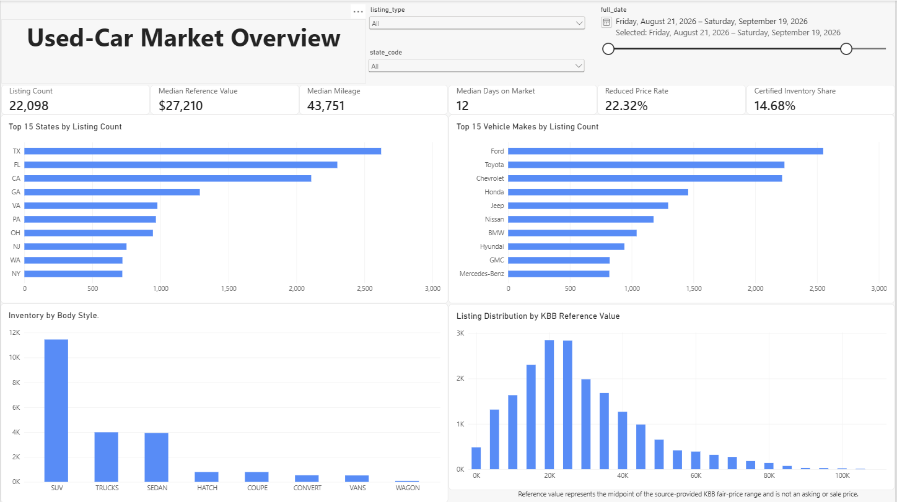
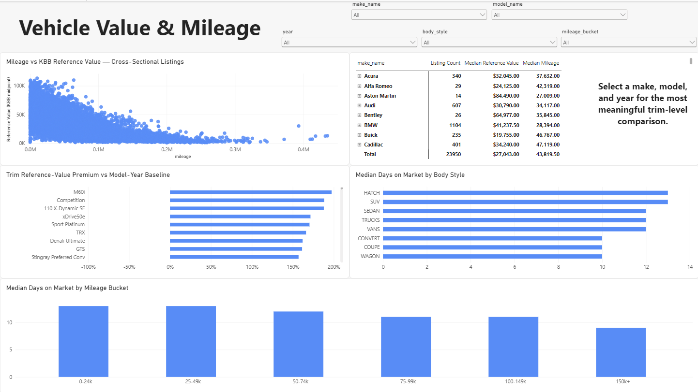
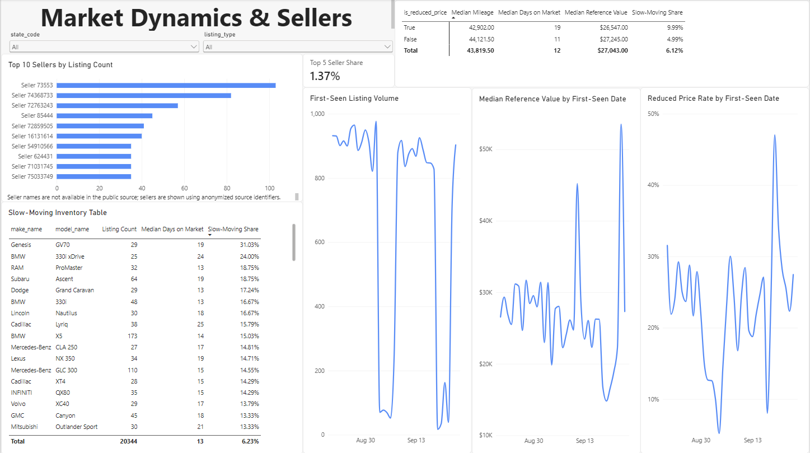

# Used-Car Market Intelligence Warehouse

An incremental analytics pipeline for U.S. used-vehicle listings. The point of the project is the **data
architecture** — source discovery, idempotent incremental loading, a JSONB raw layer, dbt transformations and tests,
a dimensional PostgreSQL warehouse, advanced SQL, Prefect orchestration and a Power BI model — not the vehicle domain.

```
Hugging Face daily Parquet partitions
  -> discovery + sha256 change detection -> contract validation (all files, before any write)
  -> atomic per-file load -> raw.autotrader_records (JSONB) + meta.processed_files / meta.pipeline_runs
  -> dbt: staging -> intermediate (dedupe, enrich) -> warehouse (1 fact, 4 dimensions)
  -> 8 SQL analyses + Power BI   (orchestrated by Prefect: used_car_market_pipeline)
```



## Business questions
What does the used-vehicle inventory look like by make, body style, region and listing type? How does KBB reference
value vary with mileage and trim? Which cohorts sit longest on the market? How concentrated is inventory among
sellers, and what do reduced-price listings look like? All answers are descriptive and cross-sectional.

## Data source, license and a hard limitation
Source: [`rebrowser/autotrader-dataset`](https://huggingface.co/datasets/rebrowser/autotrader-dataset) (Rebrowser,
public preview sample, **CC BY-NC 4.0** — attribution required, non-commercial use only; see Rebrowser's terms).
Cite: Rebrowser, *AutoTrader Vehicle Listings Dataset*, 2026, <https://rebrowser.net/products/datasets/autotrader>.
Rebrowser is not affiliated with AutoTrader. Raw Parquet files are not committed.

**`salePrice` and `vin` are redacted (`[PREMIUM]`) in the public sample.** Therefore:
- there is **no listing/asking price** analysis; `kbbFairPriceLow/High` are a KBB *reference value* range, and the
  derived midpoint is labelled "reference value", never "price";
- there is **no VIN or NHTSA enrichment**; a "vehicle" in the model is a *configuration*, not a physical car;
- the mileage-vs-value analysis is **cross-sectional**; no price-history or depreciation claims are made.

## Stack
Python 3.12, PostgreSQL 16 (Docker Compose), pandas/PyArrow, Hugging Face Hub client, psycopg 3, dbt-postgres,
Prefect 3, pytest, Power BI Desktop. No ML/LLM features.

## Warehouse model and grain
`fct_listings` — one used/certified listing (Used, Certified, Third-Party Certified; New excluded), latest observed
record. Dimensions: `dim_vehicle` (configuration), `dim_seller` (Type 1, grain `seller_id`, plus an Unknown member),
`dim_geography` (ZIP/city/state + region seed), `dim_date`. Details: `docs/data_dictionary.md`, `docs/architecture.md`.

## Incremental strategy and second-run behaviour
A file's identity is its name **plus its content hash** (Hub LFS sha256, re-verified after download) because source
partitions are revised after publication. Only unseen/changed files are downloaded; all are contract-checked before
any write; each file loads in one transaction (failure = rollback, not marked processed); rows are upserted on
`primary_key` (update only if the record hash changed and the observation is not older). Local history is never deleted
when old partitions roll off upstream. **A no-change rerun processes 0 files and leaves every table and key fingerprint
identical** (measured, `docs/acceptance_results.md`). `--revision SHA` pins the source for reproducible runs.

## Data quality
Raw: PK/uniqueness, hash checkpointing. dbt: 54 nodes in the final build = 1 seed + 8 models + 45 tests — unique/not-null keys,
foreign-key relationships, accepted listing types/regions, no negative mileage or days on market, no impossible model
year, valid reference ranges (no low > high, midpoint within range), no orphan fact keys, fact-count reconciliation,
dedupe keeps the latest observation. Pipeline smoke checks include a guard that the warehouse has no listing/asking-price column.

## Advanced SQL
Eight documented analyses in `sql/` (benchmarks, trim premiums, mileage vs reference value, slow-moving inventory,
regional mix-adjusted index, reduced-price profile, seller concentration, first-seen cohorts); results and an honest
`EXPLAIN (ANALYZE, BUFFERS)` review in `docs/sql_analysis.md`.

## Run locally
```bash
cp .env.example .env                                   # dev-only credentials
docker compose up -d                                   # PostgreSQL 16 on 127.0.0.1:5432
uv sync                                                # requires uv installed (Python 3.12)
export HF_HOME=$PWD/.cache/hf
.venv/bin/python -m src.orchestration.flow             # discover -> load -> dbt build -> smoke checks
.venv/bin/python -m pytest tests                       # unit + integration (integration needs the container)
.venv/bin/python scripts/run_acceptance.py             # all acceptance scenarios (recreates the project DB)
.venv/bin/python -m src.db.run_sql sql/01_vehicle_reference_value_benchmarks.sql
```
dbt can be run directly: `.venv/bin/python -m src.orchestration.dbt_runner build`.

## Tests and acceptance evidence
`pytest`: 40 tests (23 unit, 17 integration) pass. The acceptance suite (`docs/acceptance_results.md`, a point-in-time run on the original 30-partition revision) passed: clean
bootstrap, idempotent rerun, incremental run on real partitions, invalid-schema file (+ corrected rerun), controlled dbt
failure (+ corrected rerun) and download retry. **Real-source behaviour and fixture behaviour are separated:** the live
source has no cross-file overlap, so the changed-record upsert and deduplication paths are demonstrated only on
deterministic synthetic fixtures (`tests/`).

## Measured scale
**Final refreshed state** (source revision `f9511a90…`; 35 daily partitions held locally, 2026-08-21 – 2026-09-24):
| | |
|---|---|
| Raw records | 26,845 |
| `fct_listings` | 23,950 (21,611 market-value eligible; 2,895 New excluded) |
| `dim_vehicle` / `dim_seller` / `dim_geography` / `dim_date` | 11,590 / 8,607 / 4,318 / 48 |
| dbt | 1 seed, 8 models, 45 tests — all pass |
| SQL analyses | 8, all return rows |
| Cross-file `listingId` overlap in the real data | 0 (so `source_observation_count` = 1) |

**Refresh demonstration.** The pipeline was first built from revision `1e325fd8…` (30 partitions, 24,608 raw
records, 22,098 facts; the acceptance run in `docs/acceptance_results.md` documents that state). The source later
published five new partitions (2026-09-20 – 2026-09-24); a normal pipeline run processed only those 5 files
(2,237 rows inserted), re-ran dbt, and Power BI refreshed against the result. Earlier partitions that had rolled off
the upstream 30-file window were retained locally, as designed.

Key dashboard values (whole dataset, no slicers): Listing Count 23,950 · Median Reference Value $27,043 · Median
Mileage 43,819.5 · Median Days on Market 12 · Reduced Price Rate 22.58% · Hot Listing Rate 2.79% · Certified
Inventory Share 14.55% · Median Reference-Value Spread $2,600. These describe a capped public sample, not the market.

## Power BI dashboard
`powerbi/Used_Car_Market_Intelligence.pbix` — Import mode over the five `warehouse` tables only, single-direction
dimension-to-fact relationships, primary date relationship on `first_seen_date_key`. DAX measures are in
`powerbi/dax_measures.dax`; connection, model and refresh notes in `powerbi/README.md`. The report is a Windows
Power BI Desktop file; GitHub shows only the screenshots. The `.pbix` embeds the imported (CC BY-NC 4.0) data.





## Engineering decisions and trade-offs
- **JSONB raw layer, extraction in dbt:** schema drift in the source does not break loading; cost is a wider staging view.
- **File identity = name + content hash:** partitions are revised after publication, so name alone would miss changes.
- **Validate everything before writing anything:** one bad file fails the run with no partial raw state.
- **Configuration-grain `dim_vehicle` with a deterministic surrogate:** `kbbVehicleId` was measured to be unstable
  (1,414 of 9,268 ids span multiple configurations), so it is kept only as an attribute.
- **Reference value, not price:** the honest label costs some "wow", but avoids implying data the sample lacks.
- **Local-only scope:** single Postgres container, no cloud deployment, no streaming; fixtures cover paths the live source never exercises.

## Limitations and V2 ideas
Small capped sample (not a market census); about 10% of fact listings (2,339 of 23,950) have no valid reference range; reference value is a KBB
range, not a transaction or asking price; seller names are redacted. V2: richer incremental history if a longer-lived
source becomes available, VIN-based enrichment only if a licensed VIN field exists.
